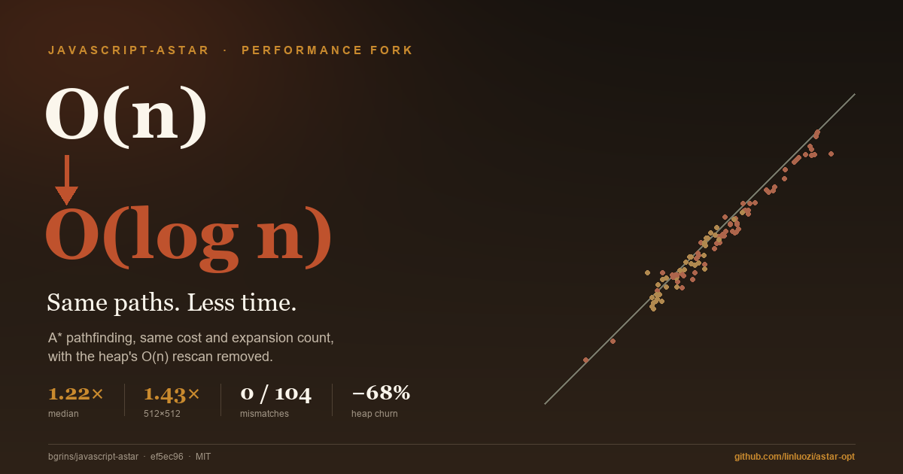
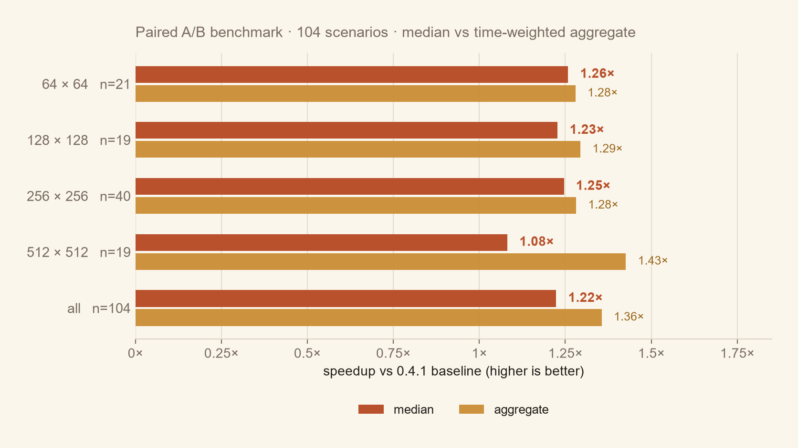
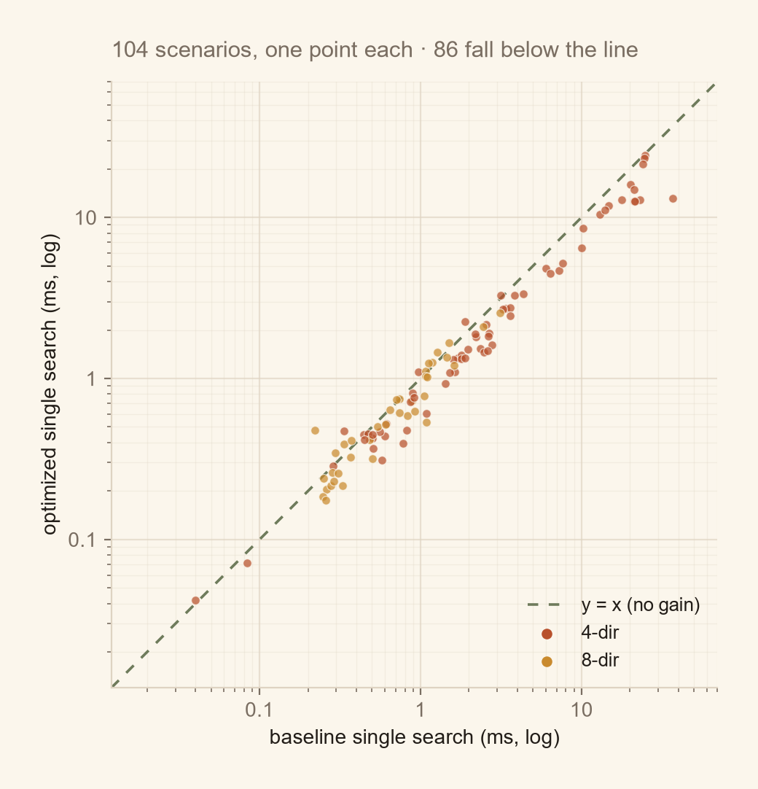

# javascript-astar



**Same paths, less time.** A performance fork of
[bgrins/javascript-astar](https://github.com/bgrins/javascript-astar) 0.4.1 that
removes the O(n) `Array.indexOf` scan from the binary heap and the per-node
neighbour array allocation — without changing the API or the search results.

[](https://github.com/linluozi/astar-opt/actions/workflows/test.yml)
[](LICENSE)

| metric | value |
|---|---|
| median speedup, 104 scenarios | **1.22×** (aggregate 1.36×) |
| 512×512 group (19 scenarios) | **1.43×** aggregate |
| 512×512, 4-dir, no walls | **1.70×** (21.2 → 12.7 ms) |
| correctness | **0 / 104** cost or expansion mismatches |
| heap churn per search | **1,315 → 417 KiB (−68%)** |





**Read more:** [OPTIMIZATION.md](OPTIMIZATION.md) (method, profile, rejected
ideas, caveats) · [generated report](https://linluozi.github.io/astar-opt/)
(Chinese, single page) · [raw per-scenario data](results/final-runs.csv).

The benchmark is a paired A/B run: baseline and optimized alternate in separate
processes, 11 searches per round, 3 rounds, median of round medians. Path cost,
path length and expansion count are identical to the original in every scenario.

## Sample Usage

If you want just the A* search code (not the demo visualization), use code like this http://gist.github.com/581352
```js
<script type='text/javascript' src='astar.js'></script>
<script type='text/javascript'>
	var graph = new Graph([
		[1,1,1,1],
		[0,1,1,0],
		[0,0,1,1]
	]);
	var start = graph.grid[0][0];
	var end = graph.grid[1][2];
	var result = astar.search(graph, start, end);
	// result is an array containing the shortest path
	var graphDiagonal = new Graph([
		[1,1,1,1],
		[0,1,1,0],
		[0,0,1,1]
	], { diagonal: true });
	
	var start = graphDiagonal.grid[0][0];
	var end = graphDiagonal.grid[1][2];
	var resultWithDiagonals = astar.search(graphDiagonal, start, end, { heuristic: astar.heuristics.diagonal });
	// Weight can easily be added by increasing the values within the graph, and where 0 is infinite (a wall)
	var graphWithWeight = new Graph([
		[1,1,2,30],
		[0,4,1.3,0],
		[0,0,5,1]
	]);
	var startWithWeight = graphWithWeight.grid[0][0];
	var endWithWeight = graphWithWeight.grid[1][2];
	var resultWithWeight = astar.search(graphWithWeight, startWithWeight, endWithWeight);
	// resultWithWeight is an array containing the shortest path taking into account the weight of a node
</script>
```
A few notes about weight values:

1. A weight of 0 denotes a wall.
2. A weight cannot be negative.
3. A weight cannot be between 0 and 1 (exclusive).
4. A weight can contain decimal values (greater than 1).

### Original (slower) implementation

The original version of the algorithm used a list, and was a bit clearer but much slower.  It was based off the [original blog post](http://www.briangrinstead.com/blog/astar-search-algorithm-in-javascript).  The code is available at: https://github.com/bgrins/javascript-astar/tree/0.0.1/original-implementation.

The newest version of the algorithm using a Binary Heap.  It is quite faster than the original.
http://www.briangrinstead.com/blog/astar-search-algorithm-in-javascript-updated
Binary Heap taken from http://eloquentjavascript.net/appendix2.html (license: http://creativecommons.org/licenses/by/3.0/)


## Running the test suite

[](https://travis-ci.org/bgrins/javascript-astar)

If you don't have grunt installed, follow the [grunt getting started guide](http://gruntjs.com/getting-started) first.

Pull down the project, then run:

		npm install
		grunt
